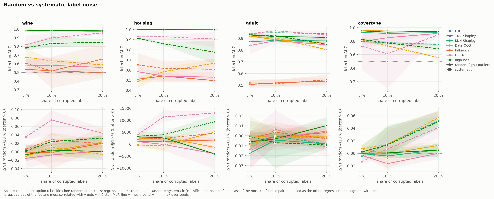
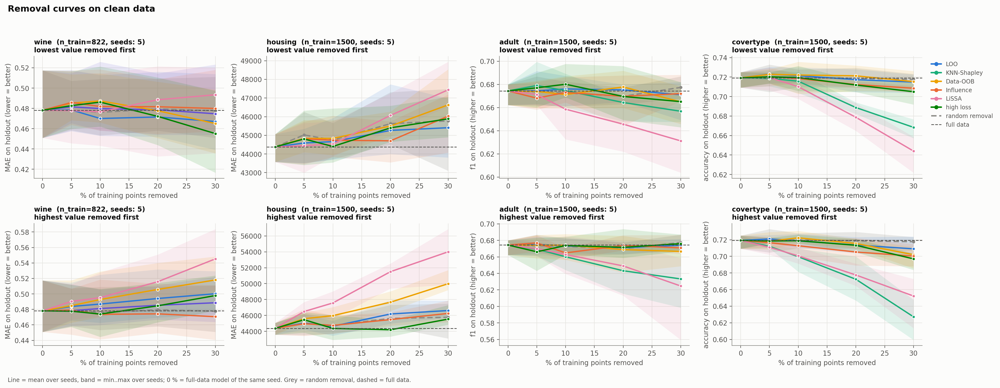
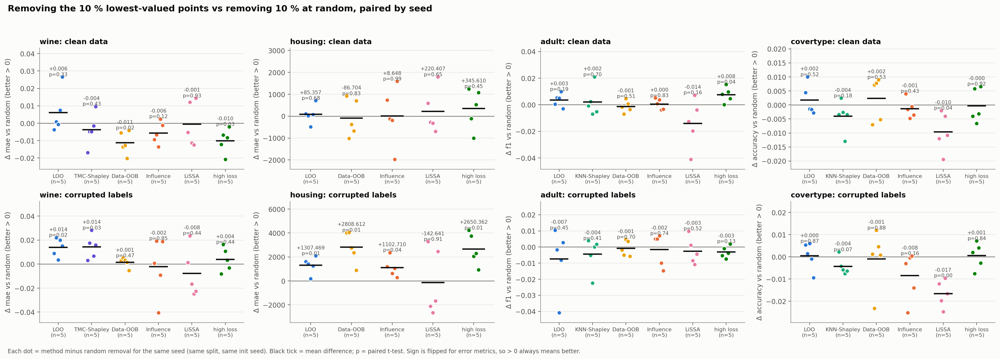
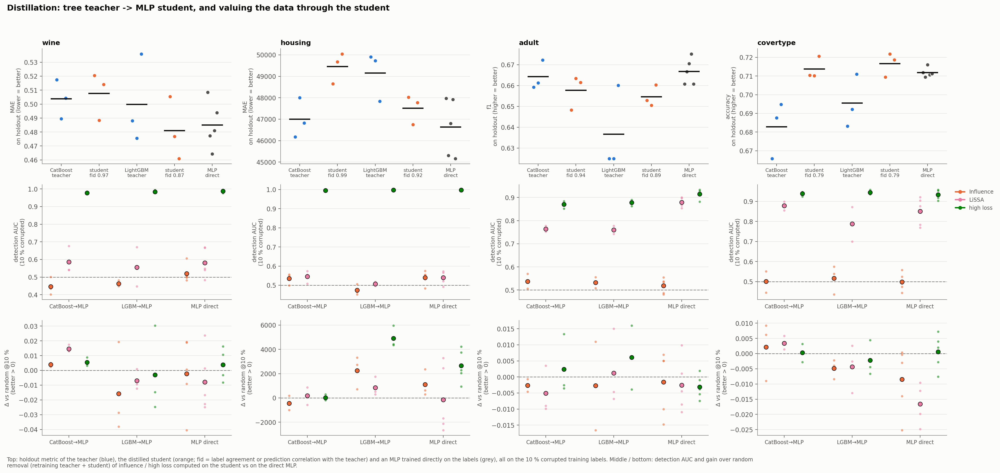
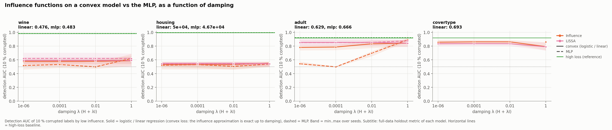
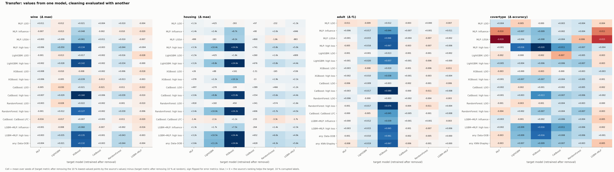
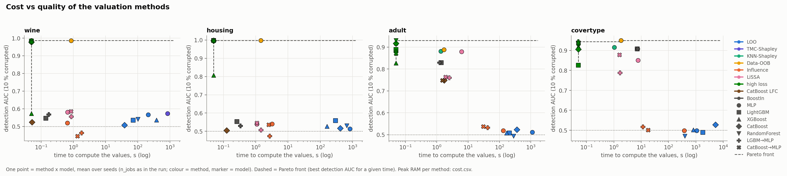

# Удаление «плохих» обучающих точек по их ценности (data valuation / influence functions)

Дипломный проект. Вопросы исследования:

1. Если оценить вклад каждой обучающей точки (LOO, Shapley, influence functions через [pyDVL](https://pydvl.org/), Data-OOB и др.) и удалить наименее ценные, станет ли модель лучше, чем при случайном удалении того же числа точек?
2. Находят ли эти оценки испорченные метки — случайные и систематические?
3. Можно ли получить influence для градиентного бустинга (GBDT) через дистилляцию в MLP, и сравним ли он со специализированными методами (BoostIn, CatBoost LossFunctionChange)?

Полный разбор результатов — [docs/RESULTS_SUMMARY.md](docs/RESULTS_SUMMARY.md). Аудит и все исправления — [FIXES.md](FIXES.md) (P1–P16).

<!-- REFRESH: числа ниже взяты из прогона 20–21.11.2026 (ok=2985, skipped=116, failed=0).
     После нового прогона: plot_results.py + paired_stats.py -> assets/, затем обновить таблицы по
     assets/summary.md, assets/paired_stats.md и docs/RESULTS_SUMMARY.md (разделы помечены «Источник»). -->

## Коротко о результатах

- **Детекция случайного шума меток.** Лучшие методы дешёвые: **Data-OOB** и **LossHigh** (высокий train loss). AUC 0.97–0.998 на регрессии и 0.89–0.95 на классификации.
  - Влияние, LOO и TMC-Shapley на MLP близки к случайному (≈ 0.5).
  - LiSSA работает только на классификации (0.85–0.88).
- **Систематический шум** (путаемая пара классов / сдвиг подгруппы) ломает Data-OOB (0.49–0.82). Лучшим становится **LiSSA** (0.90–0.96 на wine/housing/adult).
- **Очистка ≠ детекция.** На чистых данных удаление «худших» точек не помогает. При случайном шуме выигрыш над random-удалением мал и редко значим, MLP с early stopping сам устойчив. Заметный и значимый выигрыш — при **систематическом** шуме: LiSSA на housing даёт до −12 k$ MAE, на wine до −0.05 MAE.
- **GBDT-influence через дистилляцию — гипотеза в целом не подтвердилась.**
  - DirectInfluence студента ≈ случаен.
  - LiSSA студента конкурентен только на covertype с целями учителя (0.91–0.92, на уровне BoostIn).
  - Data-OOB и LossHigh лучше всех influence-методов на всех датасетах.
- **Демпфирование решает.** DirectInfluence на невыпуклом MLP при λ ≈ 1e-5 случаен. При λ = 0.1–1 детекция на классификации восстанавливается (adult 0.85–0.89, covertype 0.82–0.86), но очистку это не улучшает.
- **Регрессия при случайном шуме.** Все influence-методы ≈ 0.5 — это не ошибка. Выбросы ±3σ симметричны, и линейное приближение не определяет знак вреда, хотя по модулю выбросы видны (AUC |v| 0.85–0.91).
- **Перенос ценностей.** Модель-независимые Data-OOB/KNN-Shapley и LossHigh любой модели переносятся на другие модели. Сильнее всего выигрывает XGBoost: +0.05–0.08 F1 на adult, −24 k$ MAE на housing. LOO не переносится.
- **Цена.** Data-OOB, LossHigh, KNN-Shapley, LiSSA и BoostIn считаются за секунды. LOO и TMC-Shapley — 10–90 минут на прогон при худшем качестве.

## Что сравнивается

| | |
|---|---|
| Методы | LOO, TMC-Shapley (только wine), KNN-Shapley (классификация), Data-OOB, Influence (direct, явный гессиан), Influence (LiSSA), LossHigh (взвешенный train loss, P14), random; для деревьев ещё BoostIn (LightGBM, пакет `tree_influence`) и CatBoost LossFunctionChange |
| Модели | MLP `pytorch/simple` с ранней остановкой по val (основная); LightGBM, XGBoost, CatBoost, Random Forest; логистическая/линейная регрессия (выпуклый контроль); дистилляция дерево → MLP |
| Задача `clean` | удалить 5/10/20/30 % точек (сначала наименее ценные), переобучить, метрика на holdout |
| Задача `noise*` | испортить 5/10/20 % меток (классификация — другой класс; регрессия — y ± 3σ); detection AUC, found@k, кривые удаления |
| `sysnoise*` | систематический шум: самая путаемая пара классов / сдвиг y в подгруппе с наибольшим значением признака |
| Сиды | main (clean, noise10): 5; остальные: 3. У каждого сида своё разбиение, свой испорченный поднабор и свой seed модели; сравнение с random — парное по сидам |
| Метрики | wine/housing — MAE, adult — F1, covertype — accuracy; для классификации дополнительно holdout ROC-AUC/logloss |

Исследования: `clean`, `noise5/10/20`, `sysnoise5/10/20`, sweep чувствительности (adult), `models-*` (4 дерева × clean/noise10), `damp-linear-*` / `damp-mlp-*` (damping 1e-6 … 1), `distill-{lightgbm,catboost}-noise10[-tgtteacher]`, `transfer-*` (6 моделей-целей).

## Данные

| Имя | Задача | n_train | Источник |
|---|---|---|---|
| `wine` | регрессия | 822 | [Wine Quality](https://www.kaggle.com/datasets/yasserh/wine-quality-dataset) |
| `housing` | регрессия | 1500 | [California Housing](https://www.kaggle.com/datasets/camnugent/california-housing-prices) |
| `adult` | бинарная классификация | 1500 | [Adult Census Income](https://www.kaggle.com/datasets/uciml/adult-census-income) |
| `covertype` | 7 классов | 1500 | [Forest Cover Type](https://archive.ics.uci.edu/dataset/31/covertype) |

Код загрузчиков для `zillow`, `electric`, `mnist`, `imdb` и `cifar10` остался (используется `main.py` и микросервисом), см. [datasets/README.md](datasets/README.md).

## Результаты

### Детекция испорченных меток (noise10, MLP, 5 сидов)

Detection AUC, mean ± std (0.5 = случайно). Источник: `assets/summary.md`, RESULTS_SUMMARY §1.1.

| метод | wine | housing | adult | covertype |
|---|---|---|---|---|
| Data-OOB | **0.985** | **0.998** | 0.888 | **0.950** |
| LossHigh (P14) | **0.987** | **0.998** | **0.915** | 0.933 |
| KNN-Shapley | — | — | 0.881 | 0.916 |
| LiSSA | 0.581 | 0.539 | 0.879 | 0.851 |
| Influence (direct) | 0.519 | 0.540 | 0.519 | 0.498 |
| LOO | 0.566 | 0.514 | 0.512 | 0.498 |
| TMC-Shapley | 0.573 | — | — | — |


### Случайный и систематический шум (10 %, 3 сида)

Источник: RESULTS_SUMMARY §1.1, `assets/12_systematic_noise.png`.

| метод | wine rand / sys | housing rand / sys | adult rand / sys | covertype rand / sys |
|---|---|---|---|---|
| Data-OOB | 0.985 / 0.635 | 0.998 / 0.582 | 0.888 / 0.902 | 0.950 / 0.729 |
| LossHigh | 0.987 / 0.835 | 0.998 / 0.859 | 0.915 / 0.922 | 0.933 / 0.773 |
| KNN-Shapley | — | — | 0.881 / 0.947 | 0.916 / 0.778 |
| LiSSA | 0.581 / **0.899** | 0.539 / **0.928** | 0.879 / **0.964** | 0.851 / 0.613 |



### Очистка: удаление наименее ценных точек против случайного удаления

Средний парный выигрыш над random по сетке удаления («+» = лучше, для MAE знак развёрнут; `*` — p < 0.05). Источник: `assets/paired_stats.md`, RESULTS_SUMMARY §1.2.

| | noise10 | sysnoise10 | sysnoise20 |
|---|---|---|---|
| housing (MAE, $) | Data-OOB +1896\*, LOO +1205\* | LiSSA +8370\*, LossHigh +3663\* | LiSSA +11949\*, LossHigh +7960\*, Data-OOB +4974\* |
| wine (MAE) | LOO +0.012\* | LiSSA +0.049\*, LossHigh +0.014\* | LiSSA +0.046\*, LossHigh +0.024\* |
| adult (F1) | значимых плюсов нет | значимых плюсов нет | значимых плюсов нет |
| covertype (accuracy) | значимых плюсов нет (KNN-Shapley −0.007\*, LiSSA −0.012\*) | — | Data-OOB +0.037\*, LossHigh +0.034\*, KNN-Shapley +0.029\* |

- На чистых данных значимые эффекты только отрицательные: covertype LiSSA −0.028\*, KNN-Shapley −0.019\*.
- Для классификации удаление пропорционально классам. Поэтому взвешивание LossHigh (P14) меняет detection AUC, но не кривые.




### GBDT-influence через дистилляцию (P9–P11)

Учитель LightGBM/CatBoost на данных с 10 % шума → MLP-студент; influence считается на студенте по настоящим меткам (`true_labels`) или по целям учителя (`teacher`). 3 сида, detection AUC. Источник: RESULTS_SUMMARY §2, `assets/10_distillation.png`.

| метод | wine | housing | adult | covertype |
|---|---|---|---|---|
| студент Influence (true / teacher) | 0.45–0.46 / 0.47–0.50 | 0.47–0.54 / 0.50–0.51 | 0.53–0.54 / 0.45–0.50 | 0.50–0.52 / 0.52–0.56 |
| студент LiSSA (true / teacher) | 0.56–0.59 / 0.51–0.53 | 0.51–0.55 / 0.50–0.51 | 0.76 / 0.75–0.77 | 0.79–0.88 / **0.91–0.92** |
| BoostIn (учитель LightGBM) | 0.568 | 0.529 | 0.829 | **0.908** |
| CatBoost LFC (учитель CatBoost) | — | — | 0.748 | — (MultiClass не поддерживается) |
| Data-OOB | **0.984** | **0.998** | **0.896** | **0.950** |
| LossHigh (студент) | 0.98 | 0.995–0.998 | 0.87–0.88 | 0.94 |

**Вердикт.**
- Influence через студента не превосходит ни BoostIn, ни дешёвые критерии.
- Как метод детекции шума для GBDT гипотеза **отвергается**.
- Как приближение к BoostIn она работает только для LiSSA с целями учителя на многоклассовой задаче (covertype).
- По очистке значимых различий между методами почти нет.



### Демпфирование: выпуклая модель и MLP (P15)

DirectInfluence, noise10, 3 сида. Источник: `python scripts/p15_damp_report.py`, RESULTS_SUMMARY §3.1 и §7.3.

| λ | wine | housing | adult | covertype |
|---|---|---|---|---|
| по умолчанию (~1e-5…1e-4) | 0.53 | 0.53 | 0.52 | 0.50 |
| 1e-2 | 0.50 | 0.51 | 0.70 | — |
| 0.1 | 0.60 | 0.55 | **0.85** | **0.82** |
| 1 | 0.62 | 0.54 | **0.89** | **0.86** |
| линейная модель, любое λ | 0.58 | 0.53 | 0.78–0.84 | 0.79–0.86 |

- У невыпуклого MLP гессиан имеет околонулевые и отрицательные собственные значения, и при малом λ обратная матрица ими доминирует.
- При λ ≥ 0.1 DirectInfluence становится задемпфированным градиентным произведением (как LiSSA, у которого неявное λ_eff = 3–12).
- Выигрыш над random-удалением при этом не появляется: ни один Δ не значим.



### Чувствительность (adult, noise10, 3 сида)

Источник: RESULTS_SUMMARY §3.2, `assets/7_sensitivity.png`.

- Взвешенный LossHigh — лучший в sweep: base 0.925, full-batch 0.92, overfit 0.89.
- LiSSA лучше всего при full-batch (0.92), хуже при over/underfit (0.79/0.83).
- LOO выходит из шума только при n_train ≈ 150 (0.62).
- Underfit-конфигурация вырождена (F1 0.16).

### Перенос ценностей между моделями (noise10, 3 сида)

Выигрыш над random при удалении 10 % на модели-цели. Источник: `assets/transfer.csv`, RESULTS_SUMMARY §4.

- Data-OOB, KNN-Shapley и LossHigh с любой модели дают устойчивые плюсы. Больше всего на XGBoost: adult +0.04…0.08 F1, wine до −0.16 MAE, housing до −24 k$ MAE. LossHigh с MLP переносится на деревья так же хорошо, как «родной».
- LOO не переносится.
- CatBoost LFC на регрессии вне CatBoost вредит.



### Время расчёта ценностей

Медиана `values_s`, с. Прогон шёл 6 процессов × 2 потока, поэтому абсолютные значения завышены, но между собой сравнимы. Источник: RESULTS_SUMMARY §5, `assets/cost.csv`.

| метод | wine | housing | adult | covertype |
|---|---|---|---|---|
| LOO (MLP) | 211 | 837 | 1131 | 1070 |
| LOO (CatBoost) | 38 | 400 | 373 | 5180 |
| TMC-Shapley (MLP) | 685 | — | — | — |
| Influence direct (MLP) | 0.6 | 3.5 | 143 | 384 (пик ~7.6 ГБ) |
| LiSSA (MLP) | 0.7 | 1.4 | 7.0 | 8.9 |
| Data-OOB / KNN-Shapley | ~1 | ~1 | ~1.5 | ~1.8 |
| BoostIn / CatBoost LFC | 0.2 / 0.0 | 0.9 / 0.1 | 0.5 / 1.6 | 6.6 / — |
| LossHigh | ~0 | ~0 | ~0 | ~0 |



### Пропуски

116 единиц `skipped` (NotApplicable), упавших нет:
- 98 — KNN-Shapley на регрессии;
- 9 — CatBoost LFC на многоклассовом covertype;
- 6 — CatBoost LFC при distill с регрессией;
- 3 — явный гессиан overfit-MLP (≈ 0.79 M параметров, ~19.6 ТБ).

## Запуск

```powershell
.venv\Scripts\python.exe -m pytest tests -q                    # 59 тестов, ~1–1.5 мин (включая e2e-смоук)
.venv\Scripts\python.exe run_study.py pilot                    # ~10 мин, results/pilot (проверка, не результаты)

# полный прогон: main -> sweep -> ext (models, distill, convex, noise, transfer) -> графики + парные тесты
powershell -ExecutionPolicy Bypass -File .\run_overnight.ps1                                   # 6 процессов x 2 потока
powershell -ExecutionPolicy Bypass -File .\run_overnight.ps1 -Workers 6 -ThreadsPerWorker 2 -MinFreeMB 1000 -MaxHeavy 1
powershell -ExecutionPolicy Bypass -File .\run_overnight.ps1 -Workers 1 -NJobs 6 -Threads 2   # последовательный режим
powershell -ExecutionPolicy Bypass -File .\run_overnight.ps1 -SkipMain -Sections models,transfer

.venv\Scripts\python.exe run_study.py status                   # done/failed по исследованиям + выполняемые единицы
.venv\Scripts\python.exe run_study.py ext --sections damphigh --workers 3 --max-heavy 1   # P15: DirectInfluence, λ = 0.1 / 1
.venv\Scripts\python.exe plot_results.py --root results --out assets     # графики, summary.md/csv, cost/transfer/sensitivity.csv
.venv\Scripts\python.exe paired_stats.py --root results --out assets     # парные тесты против random -> assets/paired_stats.md
.venv\Scripts\python.exe scripts\p15_damp_report.py                      # таблица демпфирования DirectInfluence
```

- **Возобновление.** Прогон можно прервать и запустить снова: готовые `results/<study>/<dataset>/<method>/seed<k>/results.json` пропускаются. Чтобы пересчитать единицу, удалите или перенесите её папку.
- **Параллельный режим** (P12/P13): единицы (study, dataset, seed; LOO/TMC/Influence/LiSSA — отдельными единицами) раздаются spawn-процессам, длинные первыми (LPT).
  - Новая единица стартует, только если её ожидаемый пик памяти помещается в свободную RAM за вычетом `-MinFreeMB`.
  - Тяжёлые единицы (DirectInfluence с явным гессианом, ~7.6 ГБ на covertype) идут в отдельном процессе, не больше `-MaxHeavy` одновременно.
  - Результаты совпадают с последовательным режимом.
  - Полный прогон на i7-12700H / 16 ГБ при 6×2 занял ~10 ч (main 2.5 ч, sweep 2.6 ч, ext 4.9 ч).
- **Логи:** `run_logs\overnight-*.log`, `results\_logs\` (воркеры, маркеры выполняемых единиц, lock).
- **Уведомления (необязательно):** `DIPLOMA_WEBHOOK_URL`, `DIPLOMA_WEBHOOK_KEY`, `DIPLOMA_WEBHOOK_HEADER` (см. шапку `run_overnight.ps1`).
- **Зависимости:** `pip install -r requirements.txt`. `tree_influence` (BoostIn) ставится из git и собирается с Cython.

## Структура репозитория

```
run_study.py            CLI: main | sweep | ext [--sections ...] | pilot | probe | estimate | estimate-ext | status
run_overnight.ps1       полный прогон + графики (параллельно, с учётом памяти)
plot_results.py         графики 1–7, summary.md/csv; вызывает plot_extensions.py (графики 8–13)
paired_stats.py         парный t-test и bootstrap-ДИ разности с random -> assets/paired_stats.md
study/                  config.py (что запускать), data.py (сплиты, шум), values.py (все методы),
                        protocol.py (один сид: baseline -> ценности -> кривые), parallel.py (пул процессов),
                        summary.py, estimate.py, notify.py, io.py
experiments/            обучение и метрики (runner, training, metrics), BoostIn, CatBoost LFC
influence/              обёртки pyDVL (Direct, LiSSA, LOO, TMC, KNN-Shapley)
models/                 MLP/линейные модели (torch), деревья, фабрика
config/                 settings.py, datasets/<name>.py (загрузка), model_params/<name>.json
data/, utils/, visualization/   препроцессинг и утилиты (общие с main.py)
tests/                  59 тестов (аудит pyDVL, дистилляция, GBDT-influence, параллельный режим, P14)
scripts/p15_damp_report.py      сводка damping-исследований
assets/                 графики и таблицы последнего прогона (в git)
docs/                   RESULTS_SUMMARY.md (полный разбор), PYDVL_AUDIT.md, DISTILL_REVIEW.md,
                        GBDT_INFLUENCE_PLAN.md, architecture_diagrams/
main.py, microservice/  исходный пайплайн одного эксперимента и FastAPI + Streamlit UI к нему
archive/                код и ноутбуки старого пайплайна, не участвующие в исследовании (см. archive/README.md)
results/                сырые результаты по прогонам (локально, в .gitignore)
```

Микросервис (необязательно): `pip install -r microservice/requirements_microservice.txt`, затем `python microservice/run_services.py` (API :8000, UI :8501) или `docker compose up --build`. Подробнее: [microservice/README.md](microservice/README.md).

## Ограничения

- Influence functions — линейное приближение для удаления единиц точек; на 10–30 % удаления и на невыпуклом MLP это эвристика (отсюда sweep по демпфированию).
- Выборки 800–1500 точек: LOO/Shapley стоят O(n) переобучений, а при таком n эффект одной точки тонет в шуме SGD.
- При 3–5 сидах большинство различий в очистке статистически незначимы. Выводы по очистке опираются в основном на sysnoise и housing.
- KNN-Shapley в pyDVL есть только для классификации, CatBoost LFC — только для бинарной классификации и регрессии, BoostIn — только для LightGBM.

## Ссылки

Koh & Liang 2017 (influence functions) · Agarwal et al. 2017 (LiSSA) · Ghorbani & Zou 2019 (Data Shapley, TMC) · Jia et al. 2019 (KNN-Shapley) · Kwon & Zou 2023 (Data-OOB) · Brophy et al. 2023 (BoostIn) · [pyDVL](https://pydvl.org/).

MIT — см. [LICENSE](LICENSE).
