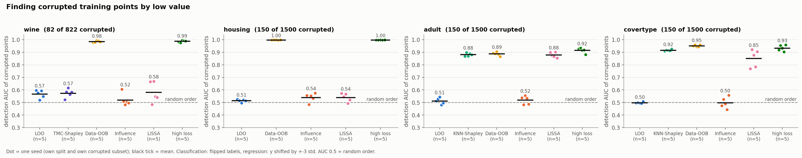

# Удаление вредных обучающих точек по их ценности



Дипломный проект. Каждой обучающей точке присваивается ценность (LOO, TMC-Shapley, KNN-Shapley, Data-OOB, influence functions через [pyDVL](https://pydvl.org/), LossHigh), после чего наименее ценные точки удаляются. Проверяется, становится ли модель лучше, чем при случайном удалении, находят ли методы испорченные метки, и можно ли получить influence для GBDT через дистилляцию в MLP. Датасеты: wine и housing (регрессия), adult и covertype (классификация), 800-1500 точек в train. Основная модель: MLP с ранней остановкой.

Полный разбор: [docs/RESULTS_SUMMARY.md](docs/RESULTS_SUMMARY.md). Исправления после аудита: [FIXES.md](FIXES.md).

## Результаты

Detection AUC испорченных точек, 10% случайного шума меток:

| Метод | wine | housing | adult | covertype |
|---|---|---|---|---|
| Data-OOB | .985 | .998 | .888 | .950 |
| LossHigh | .987 | .998 | .915 | .933 |
| KNN-Shapley | - | - | .881 | .916 |
| LiSSA | .581 | .539 | .879 | .851 |
| Influence | .519 | .540 | .519 | .498 |
| LOO | .566 | .514 | .512 | .498 |

Систематический шум 10% (путаемая пара классов или сдвиг y в подгруппе):

| Метод | wine | housing | adult | covertype |
|---|---|---|---|---|
| LiSSA | .899 | .928 | .964 | .613 |
| Data-OOB | .635 | .582 | .902 | .729 |

Выводы:

- Случайный шум лучше всего находят дешёвые Data-OOB и LossHigh. Influence и LOO на MLP близки к случайному порядку.
- При систематическом шуме Data-OOB проседает, лучшим становится LiSSA.
- Хорошая детекция не означает выигрыш от очистки. На чистых данных значимы только ухудшения. Значимый выигрыш есть при систематическом шуме: LiSSA на housing снижает MAE на 8-12 тыс. $, на wine на 0.05.
- Дистилляция GBDT в MLP почти не помогает: DirectInfluence студента 0.45-0.56, LiSSA с целями учителя на covertype 0.91-0.92 (BoostIn 0.908). Data-OOB и LossHigh лучше всех influence-методов.
- Демпфирование λ = 0.1-1 возвращает DirectInfluence на классификации (adult .85-.89, covertype .82-.86), но очистку не улучшает.

## Запуск

```powershell
pip install -r requirements.txt
.venv\Scripts\python.exe -m pytest tests -q        # 59 тестов
.venv\Scripts\python.exe run_study.py pilot        # короткая проверка, ~10 мин
powershell -ExecutionPolicy Bypass -File .\run_overnight.ps1 -Workers 6 -ThreadsPerWorker 2 -MinFreeMB 1000 -MaxHeavy 1
.venv\Scripts\python.exe run_study.py status       # прогресс
.venv\Scripts\python.exe plot_results.py --root results --out assets
.venv\Scripts\python.exe paired_stats.py --root results --out assets
```

Прогон можно прервать и продолжить: готовые единицы в `results/` пропускаются. Полный прогон на i7-12700H / 16 ГБ занимает около 10 ч.

## Структура

| Путь | Что внутри |
|---|---|
| `run_study.py`, `run_overnight.ps1` | CLI исследования и полный прогон |
| `study/` | конфиг, данные и шум, методы оценки ценности, протокол, параллельный запуск |
| `experiments/`, `influence/`, `models/` | обучение, обёртки pyDVL, BoostIn, CatBoost LFC, модели |
| `plot_results.py`, `paired_stats.py` | графики и парные тесты против random |
| `assets/` | графики и таблицы последнего прогона |
| `docs/` | разбор результатов и заметки |
| `main.py`, `microservice/` | исходный пайплайн и FastAPI + Streamlit UI |
| `tests/` | тесты |

Лицензия MIT, см. [LICENSE](LICENSE).
